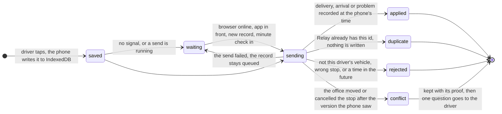
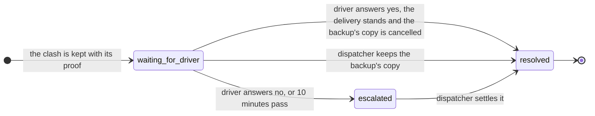
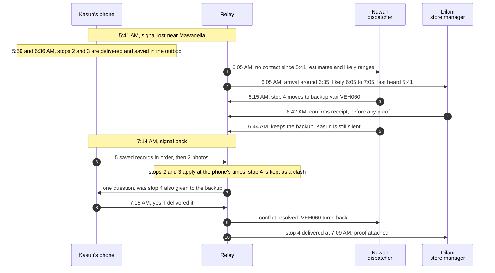

# When Kasun's Phone Loses Signal

On Wednesday 8 April 2026, a storm near Mawanella takes Kasun's phone offline from 5:41 to 7:14 AM. Kasun keeps recording deliveries while Nuwan sees no contact and an estimate, and Dilani can confirm receipt before the phone reconnects.

## What happens

- **DEG-01, 6:05 AM:** Kasun carries on offline; the Mawanella delivery is saved on Kasun's phone and Hemmathagama is next.
- **DEG-02, 7:14 AM:** The phone sends its saved records in order; Relay asks Kasun one question about Aranayake, which Nuwan also sent to Nimal.
- **DEG-03, 6:05 to 6:44 AM:** Nuwan sees no contact since 5:41, with estimates and likely ranges; Nuwan sends standby van VEH060 to Aranayake and keeps it after Dilani's receipt.
- **DEG-04, 6:05 AM:** Dilani sees an arrival estimate around 6:35 AM and a likely range while Dilani waits for Kasun's phone.
- **DEG-05, 7:16 AM:** Nuwan sees Kasun confirm the delivery; Relay settles the clash and cancels VEH060's visit.

## How Relay handles it

- The phone saves each record to IndexedDB first, then sends records in saved order when it reconnects. Each record has its own ID, so a resend is harmless.
- The office shows the last contact, an estimate and a likely range. Relay does not guess why the phone is silent.
- The dispatcher can move a stop to a suitable standby van. A store's confirmed receipt counts as a delivery; when the phone's record conflicts with the move, one question settles it.

## How a record is answered

Every record the phone sends gets one answer, and a clash with an office change is kept and settled with one question.

## The storm in order

What each screen shows between 5:41 and 7:15 AM:

## Code and tests

- Phone: [outbox.ts](../apps/web/src/offline/outbox.ts), [sync.tsx](../apps/web/src/roles/driver/sync.tsx)
- API: [estimates.py](../apps/api/src/relay_api/services/estimates.py), [field.py](../apps/api/src/relay_api/services/field.py), [backup.py](../apps/api/src/relay_api/services/backup.py)
- Tests: [offline.spec.ts](../e2e/tests/offline.spec.ts), [test_field.py](../apps/api/tests/test_field.py), [test_story_road.py](../apps/api/tests/test_story_road.py)
- Sources: [degradation spec](design/specs/spec-degradation.md), [README](../README.md), and the code above.

## Try it

1. Use the demo bar switch **Kasun's phone: no signal**, record a stop and reload the driver screen.
2. In **Demo controls**, choose **5:41 AM: Signal lost near Mawanella** and follow the offline delivery through reconnection.
3. Join the same private copy on a real phone with **Demo controls** and **Join** while online. Turn on airplane mode, record a stop, then reconnect and check that it syncs.
